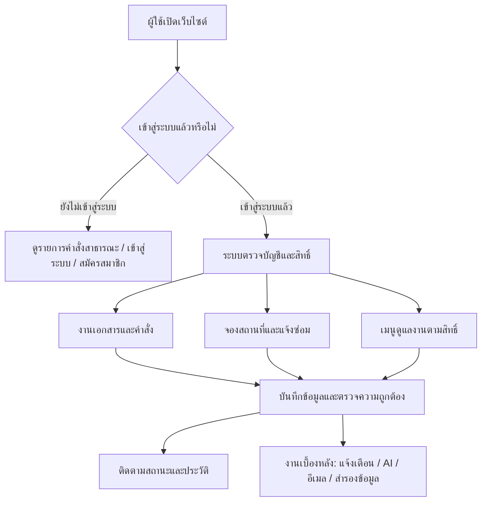
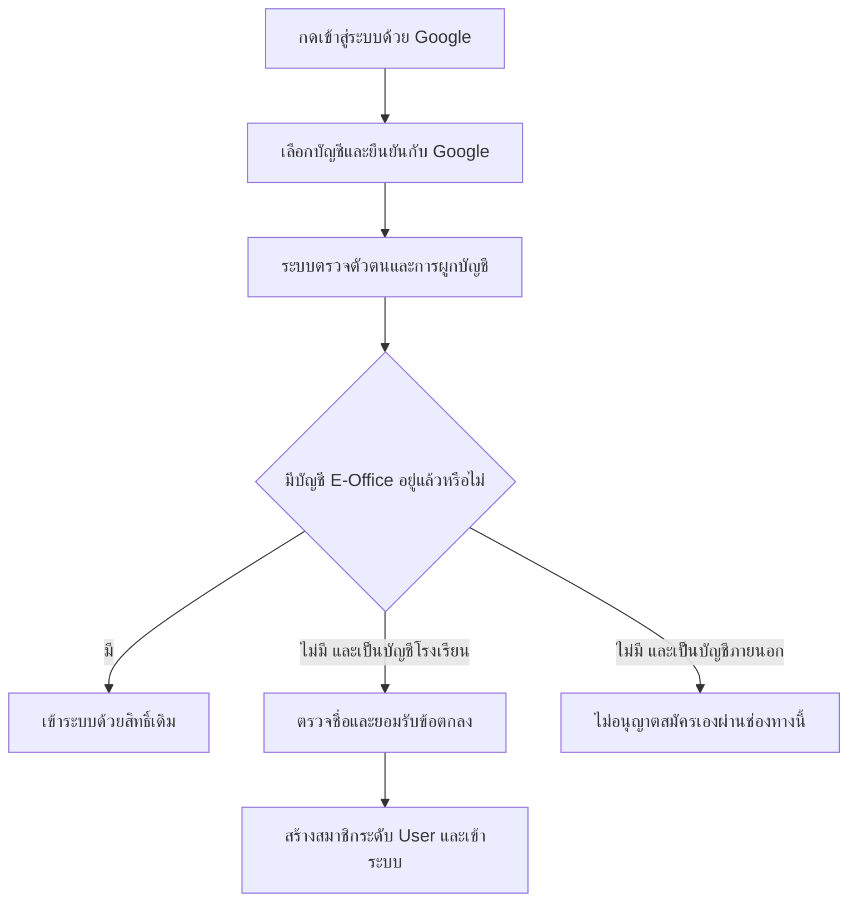
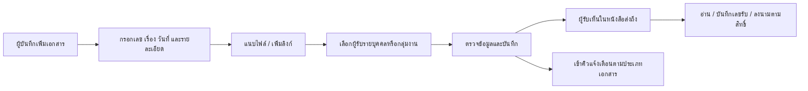
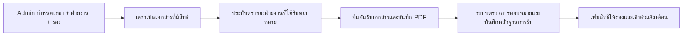
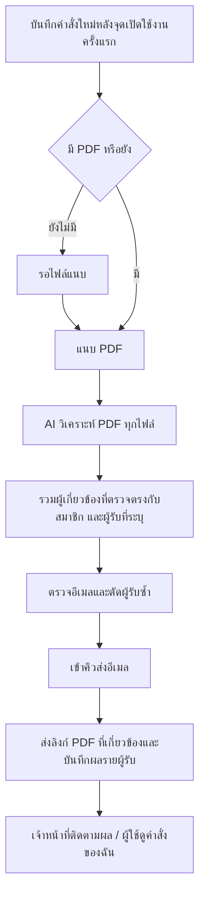
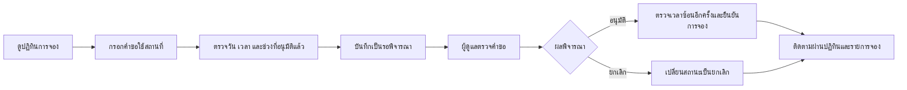
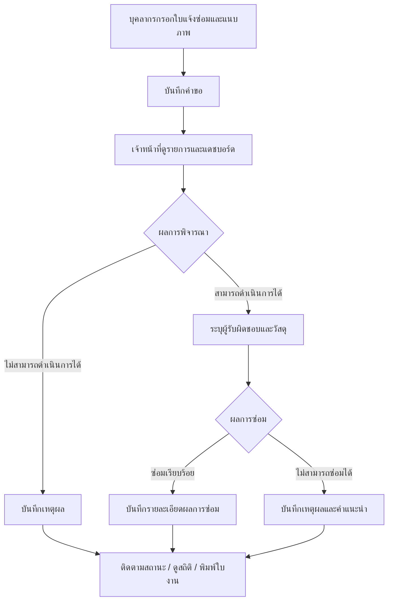
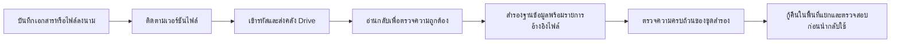

# E-Office: ภาพรวมและ Workflow ของระบบ

**ระบบหนังสือราชการและงานสำนักงาน โรงเรียนศรียานุสรณ์**

**จัดทำสำหรับ:** การนำเสนอผู้บริหารและบุคลากร

**วันที่:** 13 ตุลาคม 2569

**เว็บไซต์:** https://e-office.siya.ac.th/

> เอกสารนี้อธิบาย workflow ที่มีในระบบจากโค้ดและเอกสารของโครงการ เวอร์ชันใหม่ `461af0c` ผ่านการทดสอบแล้วแต่ยังไม่ได้ deploy ณ วันที่จัดทำ ส่วนความแตกต่างระหว่าง production และเวอร์ชันใหม่สรุปไว้ในหัวข้อ 13

---

## 1. สรุปสำหรับผู้บริหาร

**E-Office รวมงานรับ–ส่งหนังสือ ลงนาม แจ้งคำสั่ง จองสถานที่ และแจ้งซ่อมไว้ในระบบเดียว** เพื่อให้บุคลากรเข้าถึงงานตามสิทธิ์ และผู้รับผิดชอบติดตามความคืบหน้าได้จากข้อมูลส่วนกลาง

ระบบแบ่งงานหลักเป็น 3 กลุ่ม:

| กลุ่มงาน | ฟังก์ชันสำคัญ | ผลลัพธ์ |
|---|---|---|
| หนังสือราชการและคำสั่ง | ทะเบียนเอกสาร ไฟล์แนบ ผู้รับ อ่าน/ลงนาม จองเลขคำสั่ง อีเมลคำสั่ง | เอกสารมีเลขอ้างอิงและติดตามการดำเนินการได้ |
| บริการสำนักงาน | จองห้องประชุม/สถานที่ แจ้งซ่อมและติดตามผล | ผู้ขอและผู้ดูแลทำงานบนรายการเดียวกัน |
| บริหารระบบ | สมาชิก กลุ่มงาน สิทธิ์ Auto send ตั้งค่า AI และสำรองข้อมูล | กำหนดผู้รับผิดชอบและดูแลความต่อเนื่องของระบบ |

**จุดเด่นสำหรับการนำเสนอ**

- เข้าถึงเอกสารและงานตามบทบาทของแต่ละคน
- ส่งหนังสือถึงบุคคลหรือกลุ่มงาน และติดตามสถานะอ่าน/ลงนาม
- ลงนามและประทับตราบน PDF ผ่านหน้าเว็บ
- ใช้ AI ช่วยวิเคราะห์ผู้เกี่ยวข้องในคำสั่ง พร้อมให้เจ้าหน้าที่ตรวจสอบและจัดการคิวส่ง
- ตรวจเวลาจองสถานที่ซ้อนกันก่อนอนุมัติ
- เก็บรายการแจ้งซ่อม การมอบหมาย วัสดุ และผลการซ่อมในระบบเดียว
- มีระบบสำรองข้อมูลเข้ารหัสและตรวจความถูกต้องของไฟล์

## 2. ภาพรวมการทำงาน

**หลักการ:** ผู้ใช้ส่งข้อมูลผ่านหน้าเว็บ → ระบบตรวจบัญชี สิทธิ์ และข้อมูล → บันทึก → แสดงผลหรือเข้าคิวงานเบื้องหลังตามประเภทงาน

## 3. ผู้ใช้งานและสิทธิ์

| ผู้ใช้งาน | ขอบเขตการใช้งาน |
|---|---|
| ผู้เยี่ยมชม | ดูรายการคำสั่งสาธารณะ ค้นหา และเข้าสู่ระบบ/สมัครสมาชิก |
| บุคลากรทั่วไป (`User`) | ใช้เอกสารตามสิทธิ์เข้าถึง จองเลขคำสั่ง จองสถานที่ แจ้งซ่อม และดูคำสั่งของตนเอง |
| ผู้ได้รับสิทธิ์ดูแลงาน | ใช้งานทั่วไป และจัดการงานที่ได้รับมอบหมายเพิ่มเติม สามารถได้รับหลายสิทธิ์ |
| Admin สูงสุด (`Admin`) | มีทุกสิทธิ์ กำหนดสิทธิ์และระดับผู้ใช้ ตั้งค่า Auto send และ AI/อีเมล รวมถึงดูสถานะคลังเอกสาร |
| เลขา/รองที่กำหนดใน Auto send | เป็นบทบาทการส่งต่อเอกสารตามฝ่ายงาน แยกจากระดับ Admin และสิทธิ์ดูแลสมาชิก |

**สิทธิ์ดูแลงานรายบุคคล 6 ด้าน**

1. ดูแลสมาชิก
2. ดูแลกลุ่มงาน
3. ดูแลเลขคำสั่ง
4. งานอีเมล
5. ดูแลการจองห้อง
6. ดูแลงานแจ้งซ่อม

**ข้อกำหนดสำคัญ:** เฉพาะ Admin สูงสุดเพิ่ม–ถอนสิทธิ์และเปลี่ยนระดับผู้ใช้ได้ และระบบต้องเหลือ Admin สูงสุดอย่างน้อยหนึ่งคน บัญชี `Editor` เดิมยังรองรับ โดยใช้สิทธิ์รายบุคคลที่ได้รับ

## 4. Workflow: สมัครสมาชิกและเข้าสู่ระบบ

### 4.1 เข้าสู่ระบบด้วยอีเมลและรหัสผ่าน

1. ผู้ใช้กรอกอีเมลและรหัสผ่าน
2. ระบบตรวจข้อมูลบัญชีและรหัสผ่าน
3. หากถูกต้อง สร้าง session และแสดงชื่อ/เมนูตามสิทธิ์
4. ผู้ใช้เปิดโมดูลที่ต้องการ
5. เมื่อออกจากระบบ session ถูกยกเลิก

### 4.2 เข้าสู่ระบบด้วย Google

- บัญชีภายนอกที่มีในระบบแล้วใช้ได้ตามเงื่อนไขการตรวจตัวตน
- อีเมลภายนอกบางประเภทต้องยืนยันรหัสผ่าน E-Office ในการผูก Google ครั้งแรก
- การเข้าสู่ระบบ Google ไม่ได้เป็นการขอสิทธิ์เข้าถึง Google Drive ส่วนตัวของผู้ใช้

### 4.3 สมัครด้วยอีเมลโรงเรียน

กรอกชื่อและอีเมล `@siya.ac.th` → ระบบส่งอีเมลยืนยัน → เปิดลิงก์ภายใน 30 นาที → ตั้งรหัสผ่าน → สร้างบัญชีบุคลากรทั่วไป

Admin สามารถเพิ่มสมาชิกผ่านหน้าจัดการสมาชิกได้อีกช่องทางหนึ่ง

## 5. Workflow: หนังสือราชการและทะเบียนเอกสาร

### 5.1 หน้ารายการหลัก

| เมนู | ใช้สำหรับ |
|---|---|
| คำสั่ง | ค้นหาและเปิดรายละเอียดคำสั่งสาธารณะ แยกตามปี |
| หนังสือส่งถึง | หนังสือที่ส่งถึงผู้ใช้โดยตรง หรือผ่านกลุ่มงานที่ผู้ใช้สังกัด |
| ทะเบียนหนังสือรับ | ดูและจัดการเอกสารที่ตนบันทึก พร้อมค้นหาและติดตามผู้รับ |
| คำสั่งของฉัน | ดูคำสั่งที่มีประวัติส่งอีเมลสำเร็จถึงอีเมลของผู้ใช้ พร้อมไฟล์ที่เกี่ยวข้อง |

### 5.2 สร้างและส่งเอกสาร

**ข้อมูลประกอบ:** ประเภทเอกสาร เลขเอกสาร เรื่อง วันที่ เลขทะเบียนรับ หน่วยงานต้นเรื่อง ความเร่งด่วน รายละเอียดเพิ่มเติม ไฟล์แนบ ลิงก์ และผู้รับ

### 5.3 ไฟล์แนบและการนำเข้าจาก AMSS

- แนบไฟล์พร้อมชื่อที่ใช้อธิบายเอกสาร
- ลิงก์เว็บทั่วไปถูกเก็บเป็นลิงก์
- ลิงก์ PDF จาก AMSS ที่รองรับจะถูกดาวน์โหลดและเก็บเป็นไฟล์แนบ
- ระบบตรวจว่าเป็น PDF จริงและอยู่ในขนาดที่รองรับ หากนำเข้าไม่สำเร็จจะยกเลิกการบันทึกครั้งนั้น
- หลังนำเข้า AMSS สำเร็จ ลิงก์นั้นถูกเปลี่ยนเป็นรายการไฟล์แนบ

### 5.4 อ่าน แก้ไข และติดตาม

- ผู้รับเปิดเอกสารตามสิทธิ์ และระบบบันทึกสถานะอ่าน
- เจ้าของเอกสารหรือ Admin แก้ข้อมูลส่วนกลางได้ตามการตรวจสิทธิ์
- ผู้รับทั่วไปแก้ข้อมูลรับหนังสือของตนเองได้ แต่ไม่เปลี่ยนข้อมูลส่วนกลางของเจ้าของ
- ไฟล์ที่ถูกแทนที่มีการตรวจเวอร์ชัน เพื่อป้องกันการบันทึกจากข้อมูลไฟล์เก่า
- ค้นหาจากข้อมูลในทะเบียน เช่น เรื่อง เลขเอกสาร เลขทะเบียนรับ และปี
- หน้าทะเบียนมีเครื่องมือส่งออกข้อมูล Excel และเตรียมรายงานตามรายการที่เลือก

## 6. Workflow: ลงนาม PDF และ Auto send

### 6.1 ลงนามและประทับตรา

1. เปิดไฟล์จากเอกสารที่ผู้ใช้มีสิทธิ์
2. ระบบโหลด PDF และเวอร์ชันปัจจุบัน
3. ใช้เครื่องมือปากกา หรือเลือกตราพร้อมข้อมูลฝ่ายงาน/เลขรับ/วันที่/เวลา
4. วางตราและเขียนบนเอกสาร สามารถย้อนกลับการกระทำได้
5. กดบันทึก หรือดาวน์โหลด PDF ที่จัดทำ
6. ระบบตรวจสิทธิ์และเวอร์ชันก่อนบันทึกไฟล์ลงนาม

**ลักษณะการลงนาม:** ผู้ใช้เขียนลายมือและประทับภาพตราบน PDF ผ่านเว็บ จากนั้นบันทึกเป็นไฟล์ PDF เวอร์ชันลงนาม

### 6.2 ส่งต่ออัตโนมัติจากเลขาไปยังรอง

- Auto send ทำงานจากการยืนยันรับเอกสารของเลขาที่ได้รับมอบหมาย
- การใช้ปากกาลงนามอย่างเดียวไม่ทำให้ส่งต่ออัตโนมัติ
- หากรองมีสิทธิ์อยู่แล้ว ระบบไม่ล้างสถานะอ่าน/ลงนามเดิม และไม่แจ้งเตือนซ้ำจากการเพิ่มสิทธิ์เดิม
- Auto send เป็นการส่งต่อสิทธิ์เอกสาร แยกจากระบบ AI ส่งอีเมลคำสั่ง

## 7. Workflow: จองเลขคำสั่ง

**ผู้ใช้งาน:** บุคลากรที่เข้าสู่ระบบ; การแก้ไข/ลบรายการใช้สิทธิ์ดูแลเลขคำสั่ง

1. เลือกปี พ.ศ. และกรอกรายละเอียดคำสั่ง
2. กดจองเลข
3. ระบบจัดสรรเลขถัดไปของปีนั้นและบันทึกผู้จอง
4. แสดงเลข เช่น `001/2569` พร้อมรายละเอียด
5. ผู้ใช้ใช้เลขที่จองประกอบการจัดทำคำสั่ง และนำคำสั่งเข้าสู่ทะเบียนเอกสาร
6. ผู้มีสิทธิ์ดูแลสามารถแก้รายละเอียดหรือลบรายการจอง

**ผลลัพธ์:** มีทะเบียนเลขคำสั่งแยกตามปี และป้องกันเลขซ้ำเมื่อมีผู้จองพร้อมกัน การจองเลขและการบันทึกเอกสารคำสั่งเป็นคนละขั้นตอน

## 8. Workflow: อีเมลคำสั่งและ AI

### 8.1 ตั้งค่าก่อนเริ่มใช้งาน

Admin สูงสุดตั้งค่า Gemini key/โมเดล → ทดสอบการเชื่อมต่อ → เปิดส่งอัตโนมัติ → ระบบเบื้องหลังทำงานตามรอบที่กำหนด

### 8.2 ตั้งแต่บันทึกคำสั่งจนส่งอีเมล

**เงื่อนไขสำคัญ**

- คำสั่งใหม่หลังเปิดใช้งานครั้งแรกเข้าคิวอัตโนมัติ ส่วนคำสั่งเก่าต้องให้เจ้าหน้าที่นำเข้าคิวโดยเจตนา
- คำสั่งที่ลงนามนอกระบบแล้วสามารถเข้ากระบวนการนี้ได้ ไม่ต้องรอขั้นตอนลงนามบนเว็บ
- ต้องวิเคราะห์ PDF ครบทุกไฟล์ก่อนส่งอีเมล
- ส่งหนึ่งอีเมลต่อผู้รับต่อรอบงาน พร้อมลิงก์ไฟล์ที่เกี่ยวข้อง โดยตัดอีเมลซ้ำ
- การพักส่งยังเก็บงานใหม่ไว้ เมื่อเปิดอีกครั้งจะทำงานต่อ
- สถานะส่งสำเร็จหมายถึงเซิร์ฟเวอร์อีเมลรับการส่ง ไม่ใช่หลักฐานว่าผู้รับเปิดอ่านแล้ว

### 8.3 เจ้าหน้าที่ติดตามและจัดการคิว

- กรองตามปี เรื่อง และสถานะ
- ดูรายละเอียดการวิเคราะห์รายไฟล์และการส่งรายผู้รับ
- นำคำสั่งเก่าเข้าคิว เพิ่มผู้รับที่ลงทะเบียน หรือยกเลิกผู้รับที่ยังรอส่ง
- ยกเลิกงาน หรือสั่งวิเคราะห์ใหม่อย่างชัดเจน
- กรณีผลส่งไม่แน่นอน ต้องตรวจสอบก่อนสั่งส่งซ้ำ

| สถานะสำคัญ | ความหมายสำหรับผู้ใช้งาน |
|---|---|
| รอ PDF | ยังไม่มีไฟล์พร้อมวิเคราะห์ |
| รอ/กำลังวิเคราะห์ | ระบบกำลังตรวจไฟล์และผู้เกี่ยวข้อง |
| เข้าคิว/กำลังส่ง | รอหรืออยู่ระหว่างส่งอีเมล |
| สำเร็จ | ส่งผ่านเซิร์ฟเวอร์อีเมลสำเร็จตามรายการ |
| มีรายการต้องตรวจสอบ | มีบางผู้รับหรือบางขั้นตอนที่ต้องจัดการ |
| ต้องตรวจสอบ/ผลส่งไม่แน่ชัด | เจ้าหน้าที่ต้องตรวจเหตุขัดข้องหรือผลส่ง |
| ยกเลิก | งานหรือผู้รับถูกยกเลิกตามรายการ |

## 9. Workflow: จองห้องประชุมและขอใช้สถานที่

**ข้อมูลคำขอ:** ผู้ขอ หน่วยงาน สถานที่/สถานที่อื่น หัวข้อกิจกรรม จำนวนคน วัน–เวลาเริ่ม/สิ้นสุด อุปกรณ์ อาหารหรืออุปกรณ์เพิ่มเติม และการยอมรับเงื่อนไข

- ผู้ใช้ทั่วไปดูและแก้รายการของตนเองได้ตามสิทธิ์
- ผู้ดูแลการจองดูรายการทั้งหมด จัดการข้อมูล และพิจารณาสถานะ
- สถานะหลักคือ **รอพิจารณา → อนุมัติ หรือยกเลิก**
- คำขอที่รอพิจารณาไม่ใช่การรับประกันว่าห้องได้รับอนุมัติแล้ว
- ระบบตรวจเวลาซ้อนกับรายการที่อนุมัติ ทั้งตอนสร้าง/แก้ไข และก่อนอนุมัติ
- เวอร์ชันใหม่ใช้วันที่ไทย เติมเวลาสิ้นสุดข้ามวันได้ถูกต้อง และตรวจวันที่ขั้นต่ำใหม่เมื่อหน้าเปิดค้างข้ามวัน

## 10. Workflow: แจ้งซ่อมและติดตามผล

**ข้อมูลผู้แจ้ง:** ชื่อ ตำแหน่ง หน่วยงาน โทรศัพท์ วันที่ ประเภทงาน อาคาร/ห้อง รายละเอียดความเสียหาย และภาพประกอบ

**ข้อมูลเจ้าหน้าที่:** ผลพิจารณา ผู้รับผิดชอบ เหตุผลที่ดำเนินการไม่ได้ รายการวัสดุและจำนวน ผลซ่อม และรายละเอียด/คำแนะนำ

สถานะการพิจารณาและสถานะผลซ่อมเป็นคนละส่วน:

| ส่วน | สถานะ |
|---|---|
| การพิจารณา | รอดำเนินการ / สามารถดำเนินการได้ / ไม่สามารถดำเนินการได้ |
| ผลการซ่อม | รอตรวจหรืออยู่ระหว่างดำเนินการ / ซ่อมเรียบร้อย / ไม่สามารถซ่อมได้ |

แดชบอร์ดเจ้าหน้าที่แสดงจำนวนงาน ความคืบหน้า และสถิติประเภทงาน พร้อมค้นหา กรองรายการ และพิมพ์ใบงาน การจัดการผลพิจารณาและผลซ่อมต้องใช้สิทธิ์ดูแลงานแจ้งซ่อม

## 11. Workflow: บริหารสมาชิกและกลุ่มงาน

### สมาชิก

Admin หรือผู้ดูแลสมาชิกเปิดรายการ → เพิ่ม/แก้ข้อมูลสมาชิก → กำหนดกลุ่มงาน → บันทึก → ผู้ใช้มีข้อมูลและกลุ่มงานล่าสุด

- ผู้ดูแลสมาชิกมีขอบเขตจัดการบัญชีตามระดับสิทธิ์ ไม่สามารถยกระดับตนเองได้
- การแก้ข้อมูลทั่วไป การแก้สิทธิ์ และการเปลี่ยนระดับผู้ใช้เป็นคนละขั้นตอน
- การเปลี่ยนสิทธิ์มีผลกับคำขอใช้งานครั้งถัดไป เมนูตรวจใหม่เมื่อบันทึกสิทธิ์หรือกลับมาโฟกัสหน้า

### กลุ่มงาน

ผู้ดูแลเพิ่มชื่อ/รายละเอียดกลุ่มงาน → กำหนดสมาชิกในกลุ่ม → ใช้กลุ่มงานเป็นปลายทางส่งหนังสือ → สมาชิกกลุ่มเข้าถึงหนังสือตามสิทธิ์

### ตั้งค่า Auto send และ AI

Admin สูงสุดกำหนดคู่เลขา–ฝ่ายงาน–รอง และตั้งค่า AI/อีเมล เพื่อให้ workflow ส่งต่อและงานอัตโนมัติทำงานตามนโยบายที่กำหนด

## 12. Workflow: แจ้งเตือน สำรองข้อมูล และกู้คืน

### 12.1 แจ้งเตือน

บันทึกเอกสาร/เพิ่มสิทธิ์ผู้รับ → สร้างงานแจ้งเตือน → งานเบื้องหลังส่ง Email/Push ตามประเภทและช่องทางที่ตั้งค่า → บันทึกผล → retry เฉพาะกรณีที่รองรับ

สำหรับคำสั่งที่เข้าระบบส่งอัตโนมัติ อีเมลใช้คิวคำสั่งโดยเฉพาะ ส่วนการแจ้งเตือน Push ยังเป็นช่องทางแยก

### 12.2 คลังเอกสารและสำรองข้อมูล

- ไฟล์ต้นฉบับและไฟล์ลงนามเก็บเป็นเวอร์ชันแยก
- ไฟล์บน Drive เข้ารหัส ผู้ใช้ยังเปิดผ่าน URL ของ E-Office และการตรวจสิทธิ์เดิม
- นโยบายรองรับการเก็บเอกสารปีปัจจุบันและสองปีก่อนหน้าไว้ในเซิร์ฟเวอร์
- การนำไฟล์เก่าออกจากเซิร์ฟเวอร์ต้องเปิดใช้งานแยกและผ่านเงื่อนไขชุดสำรองครบถ้วน
- ชุดที่มีเฉพาะฐานข้อมูลหรือยังขาดไฟล์จะแสดงสถานะไม่ครบ ไม่ถือว่ากู้เอกสารทั้งหมดได้
- Admin ดูสถานะคลังได้ ส่วนการกู้คืนเป็นงานของผู้ดูแลระบบ

**สถานะอ้างอิง:** บันทึก deployment ล่าสุดระบุว่าเปิด synchronization ของ Drive แล้ว แต่ยังปิดการนำไฟล์ออกจากเซิร์ฟเวอร์ ไม่ใช่การยืนยันสถานะ worker แบบสด ณ เวลานำเสนอ

## 13. Production ปัจจุบันกับเวอร์ชันใหม่

| ประเด็น | Production ที่ตรวจวันที่ 13 ต.ค. 2569 | เวอร์ชันใหม่ `461af0c` |
|---|---|---|
| เมนูและหน้าโมดูล | หน้าหลักใช้รูปแบบเดิมที่เปิดโมดูลใน iframe | เปิดหน้าโมดูลโดยตรง มี sidebar/hamburger ร่วม |
| ฟังก์ชันหลัก | งานเอกสาร ลงนาม สมาชิก จองเลข ห้อง แจ้งซ่อม และอีเมลมีอยู่แล้ว | คง workflow เดิม พร้อมปรับการนำทางและ lifecycle ของฟอร์ม |
| ร่างแจ้งซ่อม/ขอใช้สถานที่ | ยังไม่มีสคริปต์ร่างชุดใหม่ | เก็บข้อความและตัวเลือกในแท็บ แยกตามบัญชีและฟอร์ม |
| การส่งฟอร์ม | พฤติกรรมเดิม | กันส่งซ้ำ รักษาการแก้เพิ่ม และตรวจเจ้าของฟอร์มก่อนใช้ผลบันทึก |
| วันที่และเวลาจอง | พฤติกรรมเดิม | วันที่ไทย เวลาข้ามวัน และตรวจ bounds เมื่อเปิดหน้าค้าง |

**ข้อควรทราบเกี่ยวกับร่างในเวอร์ชันใหม่**

- ใช้กับฟอร์มสร้างใบแจ้งซ่อมและคำขอใช้สถานที่ ไม่ใช่ทุกฟอร์มในเว็บไซต์
- เก็บใน `sessionStorage` ของแท็บ ไม่ใช่ร่างส่วนกลางที่เปิดต่อได้ทุกอุปกรณ์
- ไม่เก็บไฟล์แนบหรือภาพ ต้องเลือกใหม่เมื่อกลับมาหน้า
- มีคำเตือนก่อนออกจากหน้าหรือออกจากระบบตามสถานะร่าง
- เมื่อเปลี่ยนเป็นอีกบัญชีในหน้าเดิม ต้อง reload ก่อนส่งฟอร์ม

**ผลทดสอบก่อนนำเสนอ**

- ชุด workflow เดิมเดียวกัน **42 กรณีผ่านทั้ง baseline production และเวอร์ชันใหม่** ใน local QA
- ชุดทดสอบเวอร์ชันใหม่ผ่านครบ รวม integration **44** และ document/session race tests **12**
- ตรวจ 11 หน้าโมดูลและไฟล์ JS/CSS ของเวอร์ชันใหม่ โหลดได้ครบ
- ทดลองบันทึกผ่านฟอร์มเอกสาร จองห้อง และแจ้งซ่อมจริงใน local QA สำเร็จ
- SMTP/Push, Gemini, Drive uploads จริง และ Google login แบบใช้บัญชีจริงไม่ได้ทดสอบครบในรอบเปรียบเทียบนี้

## 14. ตัวอย่างเรื่องเล่าสำหรับนำเสนอ

### ตัวอย่างที่ 1: หนังสือถึงกลุ่มงาน

เจ้าหน้าที่บันทึกหนังสือและแนบ PDF → ส่งถึงกลุ่มบริหารที่เกี่ยวข้อง → สมาชิกเห็นหนังสือส่งถึง → เลขารับและประทับตรา → ระบบเพิ่มสิทธิ์ให้รองตาม Auto send → ติดตามสถานะอ่านและลงนาม

### ตัวอย่างที่ 2: คำสั่งแต่งตั้งคณะกรรมการ

บุคลากรจองเลขคำสั่ง → จัดทำคำสั่งและบันทึก PDF → คำสั่งเข้าคิว AI ตามเงื่อนไขเปิดใช้งาน → ระบบรวมผู้เกี่ยวข้องกับผู้รับที่ระบุ → ส่งอีเมล → เจ้าหน้าที่ติดตามผล → ผู้รับดูในคำสั่งของฉัน

### ตัวอย่างที่ 3: ขอใช้ห้องประชุม

ครูดูปฏิทิน → ส่งคำขอพร้อมวัน เวลา และอุปกรณ์ → ผู้ดูแลพิจารณา → ระบบตรวจช่วงเวลาซ้อนก่อนอนุมัติ → ผู้ขอติดตามผลในรายการจอง

### ตัวอย่างที่ 4: แจ้งอุปกรณ์ชำรุด

บุคลากรแจ้งปัญหาและแนบภาพ → เจ้าหน้าที่ตรวจและมอบหมาย → บันทึกวัสดุและผลการซ่อม → ติดตามความคืบหน้าผ่านรายการและแดชบอร์ด

## 15. โครงนำเสนอ 5–7 นาที

| ลำดับ | หัวข้อ | ประเด็นพูด |
|---|---|---|
| 1 | เป้าหมายระบบ | รวมงานเอกสารและบริการสำนักงานไว้ในจุดเดียว |
| 2 | ผู้ใช้และสิทธิ์ | บุคลากรใช้งานทั่วไป ผู้ดูแลรับผิดชอบเฉพาะงาน Admin กำหนดสิทธิ์ |
| 3 | เอกสารและลงนาม | ส่งถึงบุคคล/กลุ่ม ติดตามอ่าน ลงนาม และส่งต่อผ่าน Auto send |
| 4 | คำสั่งและ AI | จองเลข วิเคราะห์ PDF ส่งอีเมล และติดตามผล |
| 5 | ห้องประชุมและแจ้งซ่อม | ยื่นคำขอ พิจารณา ดำเนินการ และติดตามสถานะ |
| 6 | ความต่อเนื่องของข้อมูล | ตรวจสิทธิ์ เวอร์ชันไฟล์ สำรองเข้ารหัส และกู้คืน |
| 7 | การพัฒนารอบใหม่ | หน้าโมดูลโดยตรง ร่างฟอร์ม และการป้องกันข้อมูลสูญหาย |

**ข้อความปิดการนำเสนอ**

> “E-Office ช่วยให้การรับ–ส่งหนังสือและงานบริการสำนักงานมีเส้นทางการทำงานที่ชัดเจน ตั้งแต่ผู้ยื่นเรื่อง ผู้รับผิดชอบ ไปจนถึงการติดตามผล โดยใช้ข้อมูลร่วมกันและกำหนดสิทธิ์ตามหน้าที่ของแต่ละคน”

---

## ภาคผนวก: หน้าหลักที่ใช้สาธิต

| หน้าที่ต้องการสาธิต | เส้นทาง |
|---|---|
| คำสั่งสาธารณะ | `index.php?view=public` |
| หนังสือส่งถึง | `index.php?view=received` |
| ทะเบียนหนังสือรับ | `index.php?view=send_table` |
| จัดการสมาชิกและ Auto send | `management/user_manage.html` |
| จัดการกลุ่มงาน | `management/department_manage.html` |
| จองเลขคำสั่ง | `external_number_booking/external_number_booking.html` |
| คำสั่งของฉัน | `email_send/my_dashboard.html` |
| ส่งอีเมลคำสั่ง | `email_send/doc_send_email.html` |
| ตั้งค่า AI/อีเมล | `email_send/ai_settings.html` |
| ปฏิทินห้องประชุม | `room_booking/index.html` |
| ขอใช้สถานที่ | `room_booking/new_room.html` |
| รายการจองของฉัน/จัดการการจอง | `room_booking/edit_room_booking.html` |
| แจ้งซ่อม | `maintenance_requests/index.html` |
| แดชบอร์ดแจ้งซ่อมฝ่ายงาน | `maintenance_requests/admin.html` |
| สถานะคลังเอกสาร | `management/drive_archive.html` |

หน้าและคำสั่งที่ต้องใช้สิทธิ์ควรสาธิตด้วยบัญชีที่เหมาะสม แผนภาพในเอกสารใช้ Mermaid; หากเครื่องมือเปิด Markdown ไม่รองรับ Mermaid สามารถใช้ข้อความลำดับขั้นประกอบการนำเสนอได้

### เอกสารอ้างอิงของโครงการ

- [ภาพรวมและการใช้งาน](README.md)
- [สมาชิกและสิทธิ์](MEMBER_PERMISSIONS.md)
- [Google login](GOOGLE_LOGIN.md)
- [อีเมลคำสั่งและ AI](ORDER_EMAILS.md)
- [คลังเอกสารบน Drive](GOOGLE_DRIVE_ARCHIVE.md)
- [การสำรองและกู้คืน](BACKUP_OPERATIONS.md)
- [ผลการทดสอบ](TEST_REPORT.md)
- [บันทึก deployment production](PRODUCTION_DEPLOYMENT.md)
